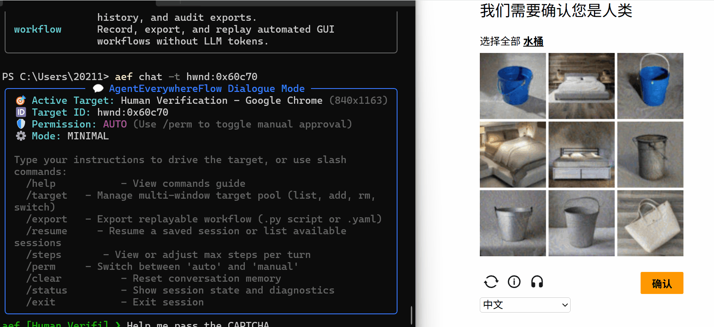
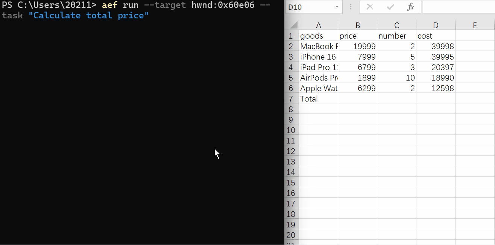
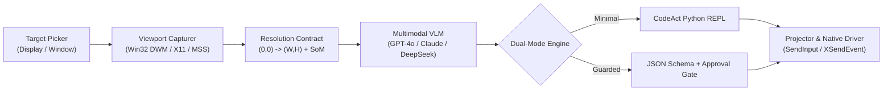

<div align="center">

# AgentEverywhereFlow

Screen-cast style viewport isolation & CodeAct execution engine for embodied desktop agents.

[](https://github.com/mcocdaa)
[](https://github.com/mcocdaa/AgentEverywhereFlow/actions)
[](https://github.com/mcocdaa/AgentEverywhereFlow/releases)
[](pyproject.toml)
[](LICENSE)

[English](README.md) · [简体中文](README_CN.md)

<br/>


<br/>
<sub>Zero-shot multimodal spatial grounding: viewport-isolated browser targeting & 9-grid visual CAPTCHA solving.</sub>

<br/><br/>


<br/>
<sub>Desktop productivity automation: isolated Excel window casting, cell localization, and <code>=SUM(D2:D6)</code> formula execution.</sub>

</div>

---

## ✨ Highlights

- **Screen-Cast Target Picker**: Bind agents to any physical monitor (`display:1`) or individual application window (`window:0x...`) just like sharing a screen in Zoom—eliminating background noise and multi-monitor coordinate distortion.
- **Explicit `(0,0) -> (W,H)` Coordinate Contract**: Every captured viewport is normalized to its local pixel space `(0, 0) -> (width, height)` with optional coordinate rulers, Set-of-Mark (SoM) overlays, and Per-Monitor DPI-v2 / X11 child hit-testing.
- **Dual-Mode Execution Engine**:
  - **Minimal Mode (CodeAct REPL)**: High-throughput Python action chaining (`click`, `type_text`, `press`, `hotkey`, `wait`, `switch_to`) in a restricted sandbox.
  - **Guarded Mode (JSON Schema)**: Deterministic atomic action validation with policy interceptors and human-in-the-loop (`manual`) approval gates.
- **Canonical HTTP/WebSocket API (`aef serve`) + Standalone WebUI**: Headless FastAPI daemon streaming real-time reasoning, action proposals, and isolated viewport frames to **[AgentEverywhereFlow-WebUI](https://github.com/mcocdaa/AgentEverywhereFlow-WebUI)**.
- **One-Click Session-to-Python/YAML Workflow Export**: Record successful agent trajectories and export them to zero-LLM Python scripts or declarative YAML workflows for deterministic replay (`aef workflow play`).
- **Multi-Target & Zero-Disturbance Headless Isolation**: Coordinate tasks across multiple bound windows (`aef chat -t "Chrome,Excel"`) or run completely silently via Windows Virtual Display Driver (VDD) and Docker + Xvfb containers.

---

## 🚀 Quick Start

### 1. Install & Configure

```bash
# Install globally as a CLI tool via uv
uv tool install "git+https://github.com/mcocdaa/AgentEverywhereFlow.git"

# Or clone for local development (Linux / Windows)
git clone https://github.com/mcocdaa/AgentEverywhereFlow.git && cd AgentEverywhereFlow
uv sync --all-extras

# Configure your VLM API key (persists to ~/.aef/.env; defaults to DeepSeek / OpenAI-compatible)
aef config --set-key "sk-your-api-key"
aef config --set-model "gpt-4o" --set-base "https://api.openai.com/v1"
```

### 2. Summon & Run

```bash
# Interactive screen-cast target picker & agent summoner
aef summon

# Run an autonomous task directly against a window title substring
aef run --target "Chrome" --task "Select all cat tiles in the 9-grid CAPTCHA and click Verify"

# Multi-window interactive session with human-in-the-loop confirmation gate
aef chat --target "Chrome,Excel" --permission manual

# Replay an exported workflow with zero LLM token usage
aef workflow play ~/.aef/workflows/sales_pipeline.yaml --speed 1.5
```

### 3. Launch WebUI Studio & Daemon (`aef serve`)

```bash
# Start the canonical HTTP + WebSocket service daemon (OpenAPI docs at http://127.0.0.1:8000/docs)
aef serve --host 127.0.0.1 --port 8000

# Or launch the interactive browser WebUI directly
aef ui
```

### 4. Python SDK

```python
from agenteverywhereflow.agent.loop import AgentLoop
from agenteverywhereflow.capturer import get_capturer
from agenteverywhereflow.config import AppConfig, ExecutionMode

target = get_capturer().list_targets()[0]
loop = AgentLoop(app_config=AppConfig(default_mode=ExecutionMode.MINIMAL_PYTHON))
loop.run(target=target, user_task="Fill the form and click submit")
```

---

## 🤖 AI & Headless API

When `aef serve --port 8000` is running, external orchestrators, CI pipelines, and AI agents can drive desktop sessions, export trajectories, and trigger zero-LLM replays over REST and WebSocket (`/api/v1/sessions/{id}/ws`):

```bash
# 1. Create a viewport-isolated session bound to a target window or display
curl -X POST http://127.0.0.1:8000/api/v1/sessions \
  -H "Content-Type: application/json" \
  -d '{"target_id": "window:0x3400012", "mode": "minimal_python", "permission_mode": "auto"}'

# 2. Export the recorded session trajectory as a deterministic YAML workflow (or format=python)
curl "http://127.0.0.1:8000/api/v1/sessions/session-abcd-1234/export?format=yaml"

# 3. Validate (dry_run) or replay a recorded workflow with zero LLM calls
curl -X POST http://127.0.0.1:8000/api/v1/workflows/run \
  -H "Content-Type: application/json" \
  -d '{"session_id": "session-abcd-1234", "dry_run": false, "step_delay": 0.2}'
```

---

## 🏗️ Architecture & Docs



### Documentation & Ecosystem

- **Companion Web Console**: **[AgentEverywhereFlow-WebUI](https://github.com/mcocdaa/AgentEverywhereFlow-WebUI)** — React 19 + Tailwind v4 visual studio with live viewport HUD, CoT stream, approval gate, and 1-click script export.
- **Technical Guides (`docs/`)**:
  - [Architecture & Coordinate Projection](docs/architecture.md) · [Vision Pipeline & SoM Calibration](docs/vision_and_som.md)
  - [Dual-Mode Execution Engine](docs/dual_mode_engine.md) · [Dialogue & Permission Gate](docs/dialogue_and_permission.md)
  - [Multi-Target & Workflow Replay](docs/multi_target_and_workflow.md) · [WebUI & REST/WS API Spec](docs/webui_and_integration.md)
  - [Headless Isolation Guide (Windows VDD & Docker Xvfb)](docs/headless_guide.md) · [Benchmarks](benchmarks/README.md)
- **Contributing & License**: See [CONTRIBUTING.md](CONTRIBUTING.md), [AGENTS.md](AGENTS.md), and [MIT License](LICENSE).
