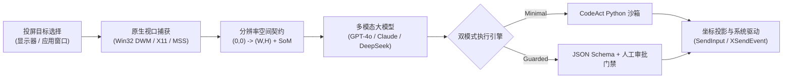

<div align="center">

# AgentEverywhereFlow

面向具身桌面智能体的投屏级视口隔离与 CodeAct 自动化执行引擎。

[](https://github.com/mcocdaa)
[](https://github.com/mcocdaa/AgentEverywhereFlow/actions)
[](https://github.com/mcocdaa/AgentEverywhereFlow/releases)
[](pyproject.toml)
[](LICENSE)

[English](README.md) · [简体中文](README_CN.md)

<br/>


<br/>
<sub>零样本视觉空间定位：投屏级浏览器窗口视口隔离与九宫格人机验证自动破解。</sub>

<br/><br/>


<br/>
<sub>桌面办公自动化闭环：独立投屏绑定 Excel 窗口，精准定位单元格并注入 <code>=SUM(D2:D6)</code> 公式完成统计。</sub>

</div>

---

## ✨ 核心特性

- **投屏级视口选择器 (Screen-Cast Target Picker)**：像在腾讯会议/Zoom 中发起屏幕共享一样，将智能体精准绑定至任意物理显示器（`display:1`）或独立应用窗口（`window:0x...`），彻底消除全屏背景噪音与多屏负坐标畸变。
- **严格 `(0,0) -> (W,H)` 空间分辨率契约**：每个捕获视口均严格归一化为局部像素空间 `(0, 0) -> (width, height)`，内置可选坐标标尺、Set-of-Mark (SoM) 视觉标记以及 Windows DPI-v2 / X11 递归子控件命中测试。
- **双模式执行引擎 (Dual-Mode Execution)**：
  - **极简模式 (Minimal CodeAct REPL)**：在受限沙箱中单轮链式编排并执行 Python 动作代码（`click`, `type_text`, `press`, `hotkey`, `wait`, `switch_to`）。
  - **受控模式 (Guarded JSON Schema)**：严格的原子动作 Schema 校验，配合高危操作拦截器与人机确认门禁（`manual` 审批流）。
- **标准 HTTP/WebSocket 服务 (`aef serve`) + 独立 WebUI 控制台**：无头 FastAPI 守护进程实时推送思维链 (CoT)、动作提议与隔离视口画面，无缝对接官方独立前端 **[AgentEverywhereFlow-WebUI](https://github.com/mcocdaa/AgentEverywhereFlow-WebUI)**。
- **一键导出 Python/YAML 工作流与确定性重放**：自动录制成功执行的会话轨迹，一键导出为零大模型开销的独立 Python 脚本或声明式 YAML 工作流（`aef workflow play`）。
- **跨窗口协同与纯后台无感隔离**：支持单会话同时绑定多个应用窗口协同操作（`aef chat -t "Chrome,Excel"`），并提供 Windows 虚拟显示器 (VDD) 与 Docker + Xvfb 无头容器方案。

---

## 🚀 快速开始

### 1. 安装与配置

```bash
# 通过 uv 全局安装 CLI 工具
uv tool install "git+https://github.com/mcocdaa/AgentEverywhereFlow.git"

# 或克隆仓库进行本地开发（支持 Linux / Windows）
git clone https://github.com/mcocdaa/AgentEverywhereFlow.git && cd AgentEverywhereFlow
uv sync --all-extras

# 一键配置多模态模型 API Key（自动持久化至 ~/.aef/.env，默认兼容 DeepSeek / OpenAI 接口）
aef config --set-key "sk-your-api-key"
aef config --set-model "gpt-4o" --set-base "https://api.openai.com/v1"
```

### 2. 召唤与执行

```bash
# 启动交互式投屏目标选择器并召唤智能体
aef summon

# 按窗口标题关键字直接绑定并执行自主任务
aef run --target "Chrome" --task "在当前九宫格人机验证中找出所有包含猫咪的方格依次点击，然后点击验证"

# 跨窗口连续多轮对话，并开启人工安全审批门禁
aef chat --target "Chrome,Excel" --permission manual

# 零 Token、零大模型调用的确定性高速重放录制工作流
aef workflow play ~/.aef/workflows/sales_pipeline.yaml --speed 1.5
```

### 3. 启动 WebUI 控制台与后台服务 (`aef serve`)

```bash
# 启动标准 REST + WebSocket 服务守护进程（Swagger 文档位于 http://127.0.0.1:8000/docs）
aef serve --host 127.0.0.1 --port 8000

# 或直接在浏览器中拉起交互式 WebUI Studio
aef ui
```

### 4. Python SDK 调用

```python
from agenteverywhereflow.agent.loop import AgentLoop
from agenteverywhereflow.capturer import get_capturer
from agenteverywhereflow.config import AppConfig, ExecutionMode

target = get_capturer().list_targets()[0]
loop = AgentLoop(app_config=AppConfig(default_mode=ExecutionMode.MINIMAL_PYTHON))
loop.run(target=target, user_task="录入表单数据并点击提交按钮")
```

---

## 🤖 AI 与 API 调用

当 `aef serve --port 8000` 运行时，外部编排系统、CI 流水线或上层 AI 智能体可通过 REST API 与全双工 WebSocket（`/api/v1/sessions/{id}/ws`）直接驱动桌面会话、导出轨迹并触发零 LLM 重放：

```bash
# 1. 创建绑定至指定应用窗口或显示器的隔离视口会话
curl -X POST http://127.0.0.1:8000/api/v1/sessions \
  -H "Content-Type: application/json" \
  -d '{"target_id": "window:0x3400012", "mode": "minimal_python", "permission_mode": "auto"}'

# 2. 将已录制的会话轨迹导出为声明式 YAML 工作流（或指定 format=python 导出独立脚本）
curl "http://127.0.0.1:8000/api/v1/sessions/session-abcd-1234/export?format=yaml"

# 3. 校验（dry_run）或免大模型确定性重放已录制的工作流
curl -X POST http://127.0.0.1:8000/api/v1/workflows/run \
  -H "Content-Type: application/json" \
  -d '{"session_id": "session-abcd-1234", "dry_run": false, "step_delay": 0.2}'
```

---

## 🏗️ 架构与文档



### 深入文档与生态

- **独立 Web 控制台伴侣**：**[AgentEverywhereFlow-WebUI](https://github.com/mcocdaa/AgentEverywhereFlow-WebUI)** —— 基于 React 19 + Tailwind v4 打造的可视化工作台，支持实时视口坐标 HUD、思维链流式展示、人工安全审批门禁与一键脚本导出。
- **技术专题文档 (`docs/`)**：
  - [核心架构与坐标投影契约](docs/architecture.md) · [视觉标定与 SoM 流水线](docs/vision_and_som.md)
  - [双模式执行引擎详解](docs/dual_mode_engine.md) · [多轮对话与权限安全门禁](docs/dialogue_and_permission.md)
  - [跨窗口协同与工作流重放](docs/multi_target_and_workflow.md) · [WebUI 与 REST/WS 接口规范](docs/webui_and_integration.md)
  - [纯后台无感运行与无头隔离指南 (Windows VDD & Docker Xvfb)](docs/headless_guide.md) · [端到端基准测试集](benchmarks/README.md)
- **贡献与开源协议**：请参阅 [CONTRIBUTING.md](CONTRIBUTING.md)、[AGENTS.md](AGENTS.md) 与 [MIT 许可证](LICENSE)。
